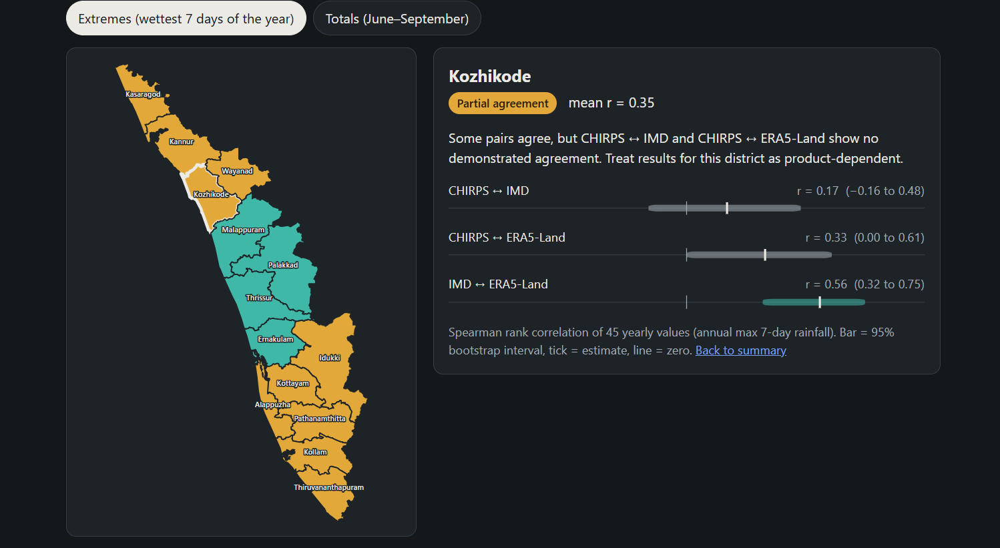

# How far can gridded rainfall be trusted for extremes in Kerala districts?

**Live map:** https://eldho-joshy.github.io/kerala-rainfall-extremes/



**In short:** three rainfall products (CHIRPS, IMD, ERA5-Land) agree on how wet a season was in all 14 Kerala districts,
but agree on year-to-year *extremes* (the wettest 7 days of each year) in only 4. The Western Ghats districts
(Idukki, Pathanamthitta, Wayanad) are among the weakest. Agreement means the products are consistent with each other, not that any of them is right.

A benchmark of three daily rainfall products for Kerala's 14 districts, 1981–2025:
**CHIRPS v2** (satellite + gauge blend, 0.05°), **IMD gridded rainfall** (gauge-based, 0.25°) and
**ERA5-Land** (reanalysis, 0.1°).

**Question:** where, and at what time scale, do these products agree on extreme rainfall?

**What this project does NOT claim:** any trend in extreme rainfall, any flood prediction, or any
measure of damage. "Agreement" below means the products are *consistent with each other*; it is
**not accuracy**. No station ground truth is used.

> **Origin of this question.** The project started as "rainfall vs flood/landslide damage by district".
> That was dropped after a data audit: EM-DAT has only ~29 Kerala flood/landslide/storm rows since 2000,
> most of them multi-state events with impact totals that cannot be split by district.

## Data audit
| Source | What it gives | Problems found |
|---|---|---|
| CHIRPS v2 via NOAA ERDDAP mirror | daily rain | **Unusable**: only 4,572 days, starts 1984, gap 2017-01-01 to 2019-12-31. Replaced by Google Earth Engine (`UCSB-CHG/CHIRPS/DAILY`). |
| CHIRPS v2 via Earth Engine | daily rain, 1981– | Used. District means of 0.05° cells. |
| IMD gridded rainfall (`imdlib`) | daily rain, 0.25° | Used. Day ends 08:30 IST: matches CHIRPS day d with IMD day d+1 (see Findings). |
| ERA5-Land via Earth Engine | daily rain, 0.1° | Used. Reanalysis, not an observation. |
| District boundaries: FAO GAUL 2015 (Earth Engine) | 14 Kerala districts | **Deprecated** asset (superseded by GAUL 2025, not yet tested). Spells Pathanamthitta as "Pattanamtitta". Idukki/Ernakulam boundary looks shifted (Idukki 5,010 km² vs ~4,360 census; Ernakulam 2,305 vs ~3,070). Some districts came back as GeometryCollections and were flattened to polygons for the map. |
| EM-DAT | disaster events | No district-level data; `GADM Admin Units` stop at state level. |
| NIDM *Kerala Floods 2018*, Table 3.1 (CWC) | official district rainfall, 1 Jun–22 Aug 2018 | One event only. Used as a rough check, not as ground truth (see Findings 2). |

## Method
1. District-mean daily rainfall for each product (`src/export_gee.py`, `export_era5.py`, `export_imd.py`).
2. Align day boundaries (`src/lag_scan.py`).
3. For time scales of 1, 3, 7, 15, 30 days: take each product's **annual maximum k-day rainfall total** per district,
   rank-correlate the 45 yearly values between each pair of products (`src/accumulation_scan.py`, `src/three_way.py`).
4. 95% bootstrap CIs by resampling years. The "best pair vs runner-up" test is a **paired** bootstrap on the same resamples.
5. Per-district tiers (`src/reliability.py`), fixed in advance: **agree** = all three product pairs have a CI entirely above 0;
   **partial** = at least one pair does, not all; **none** = no pair does.

## Findings
1. **Day boundaries differ.** CHIRPS day *d* matches IMD day *d+1* best (median monsoon daily correlation 0.26 → 0.37
   after alignment; Idukki 0.15 → 0.29). ERA5-Land aligns with CHIRPS at lag 0.
2. **Gridded district totals disagree with the official 2018 figures.** For 1 June–22 August 2018, the median absolute
   difference from NIDM Table 3.1 is about 20% (CHIRPS), 17% (IMD) and 32% (ERA5-Land, which reads low everywhere: 44–95% of official).
   Idukki: official 3,556 mm vs 1,311 (CHIRPS), 1,941 (IMD), 1,562 (ERA5-Land).
   District *ranking* vs the official table: ERA5-Land 0.76, IMD 0.45, CHIRPS 0.27 (Spearman, n=14).
   The official table may not be a true area average; I cannot tell which source is right.
3. **Single-day extremes:** only IMD and ERA5-Land agree (median Spearman 0.33, 95% CI 0.17–0.44).
   CHIRPS agrees with neither (≈0, CI includes 0).
4. **Agreement grows with window length** (median across districts, best pair): 1-day 0.33 · 3-day 0.40 · 7-day 0.48 · 15-day 0.53 · 30-day 0.53 ·
   monsoon total 0.71 · annual total 0.71.
5. **CHIRPS is the candidate outlier for short windows.** Paired-bootstrap test of best pair vs runner-up:
   clear at 1 day; marginal at 3 and 7 days (lower CI bounds +0.04 / +0.03; treat as suggestive);
   unclear at 15 and 30 days and for seasonal totals.
6. **Wayanad:** CHIRPS–IMD agreement is indistinguishable from zero at every window up to 30 days (−0.23 to 0.07);
   IMD and ERA5-Land agree there (0.54–0.63 at 7–30 days).
7. **Per-district tiers (see the map).**
   *Seasonal totals (Jun–Sep):* all 14 districts are "agree" (mean pairwise r 0.51–0.74).
   *Annual maximum 7-day rainfall:* 4 districts "agree" (Malappuram, Thrissur, Ernakulam, Palakkad), 10 "partial", none with no demonstrated agreement.
   The Ghats districts are all "partial": Idukki (mean r 0.25), Pathanamthitta (0.28), Wayanad (0.35).
   "Agree" is a low bar: it means significantly positive, not strong (Ernakulam is "agree" at mean r 0.46).

## Limitations
- 45 years and 14 districts: per-district intervals are wide, and districts near a tier boundary can flip
  (e.g. Kozhikode's CHIRPS–ERA5-Land interval starts at 0.00).
- No station ground truth. CHIRPS and IMD both ingest rain-gauge data, so they are not fully independent.
- 7 time scales × 3 pairs tested, and 14 districts × 3 pairs for the tiers, with no multiple-comparison correction.
- IMD is 0.25° (~25 km); small districts such as Alappuzha span few cells.
- **Different district polygons per product:** CHIRPS and ERA5-Land use FAO GAUL 2015; IMD uses `imdlib`'s built-in
  district outlines. Where outlines differ, part of the "disagreement" may be different areas, not different rain.
  Not yet tested.
- GAUL 2015 is deprecated and has a visible Idukki/Ernakulam offset.

## Reproduce
```
pip install -r requirements.txt
earthengine authenticate
python src/export_gee.py  --project <your-cloud-project> 1981 2025   # CHIRPS
python src/export_era5.py --project <your-cloud-project> 1981 2025   # ERA5-Land
python src/export_imd.py 1981 2025                                    # IMD
python src/lag_scan.py 1981 2025
python src/accumulation_scan.py 1981 2025 -1
python src/three_way.py 1981 2025
python src/validate_2018.py
python src/reliability.py 1981 2025                                   # per-district tiers
python src/export_boundaries.py --project <your-cloud-project>        # district polygons for the map
python src/build_map.py                                               # writes docs/index.html
```
Raw data is gitignored; all processing is in `src/`. The map is a single self-contained page in `docs/`, published with GitHub Pages.

## Status
- [x] CHIRPS, IMD, ERA5-Land district exports 1981–2025
- [x] Day-alignment, validation against official 2018 totals
- [x] Agreement by time scale with bootstrap CIs, three-way outlier test
- [x] Per-district reliability tiers
- [x] Interactive map (GitHub Pages)
- [ ] Re-clip IMD with the same GAUL polygons as the other two products (robustness check)
- [ ] Try the GAUL 2025 boundaries
